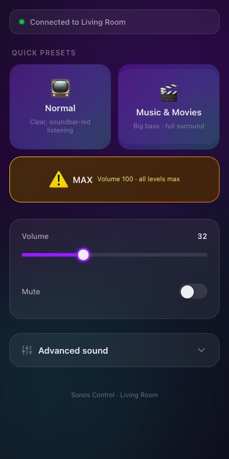

# Cronos

A one-page Sonos remote for a home theater. I built it for a family member who hates the Sonos app: open a bookmark on your phone, tap a preset, done.



## Features

- **One-tap presets.** *Normal* (soundbar-led, clear dialogue) and *Music & Movies* (heavy sub, full surrounds) each set the whole mix at once and leave the volume alone. *MAX* is marked as a hazard and sets volume to 100 only after every other setting has applied. If any of those writes fail, the volume doesn't change.
- **Advanced sound panel.** Bass, treble, sub level, TV and music surround levels, surround mode, height, loudness, night sound, and speech enhancement. The panel only shows the controls your speakers actually report, and reads the values back after each change.
- **Safe writes.** Every value is range-checked, and writes go to the speakers one at a time, so quick taps can't collide. Opening the page never applies a preset.
- **Any room.** Defaults to the room named "Living Room". Add `?room=Kitchen` to the URL to control a different one.
- **Mix API.** `GET /{room}/mix` returns every supported setting with its range, and `GET /{room}/mix/{key}/{value}` sets one. The rest of the [node-sonos-http-api](https://github.com/jishi/node-sonos-http-api) routes (`/zones`, `/{room}/volume/20`, and so on) still work.

## Requirements

- Node.js 22 or newer
- A machine on the same network as your Sonos speakers that stays on (a Raspberry Pi, a home server, or a Mac)

## Run it

```bash
npm ci
npm start
```

Then open `http://<that machine's address>:5005/` on any phone or computer on the network, and add it to the home screen.

Speakers are found automatically. If discovery doesn't work on your network, or you want to change the port, add a `settings.json`. The options are documented in the [upstream README](https://github.com/jishi/node-sonos-http-api#settingsjson).

## Tests

```bash
npm test
```

38 tests run against a simulated speaker. They cover the mix API (reading, validation, write ordering, hardware detection) and the page logic (preset recipes, the MAX safety order, stored presets, room targeting). No real speakers are needed.

## What's mine and what's upstream

Cronos is a fork of [jishi/node-sonos-http-api](https://github.com/jishi/node-sonos-http-api), which handles speaker discovery and the HTTP API. I added:

| Path | What it is |
|---|---|
| `static/index.html` | The web app: presets, controls, room targeting |
| `lib/helpers/mix-control.js`, `lib/actions/mix.js` | The `/mix` API: reads and writes Sonos EQ and rendering settings, with hardware checks |
| `lib/actions/surround.js` | Sets surround levels directly over SOAP, because the bundled discovery library can't |
| `lib/sonos-http-api.js` | No-cache API responses, and an error inside one action can't crash the server |
| `test/` | The test suite |

## License

MIT, same as upstream. See [LICENSE.md](LICENSE.md).
